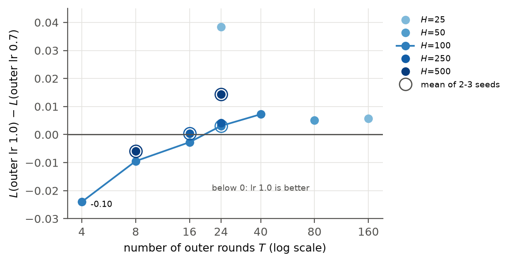
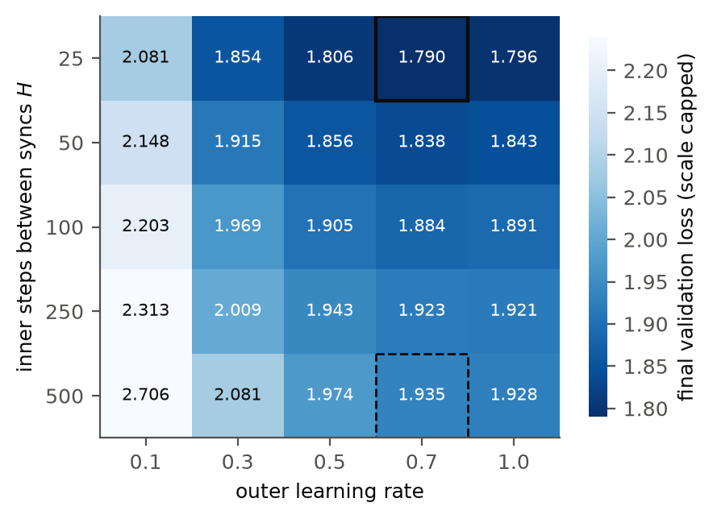
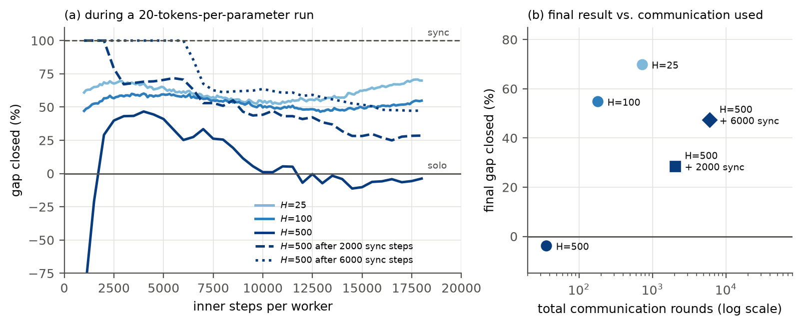

# DiLoCo on a Single Consumer GPU


Authors: [Andrew Gyakobo](https://github.com/Gyakobo), Felix Schmidt

A special thanks to [Andrej Karpathy](https://github.com/karpathy), whose [nanoGPT](https://github.com/karpathy/nanoGPT) and *Neural Networks: Zero to Hero* series this project is built on, and to the authors of [DiLoCo](https://arxiv.org/abs/2311.08105) and [Scaling Laws for DiLoCo](https://arxiv.org/abs/2503.09799), whose findings we set out to test.

>[!NOTE]
>This folder accompanies our paper **"[Re] Communication-Efficient Language Model Training Scales Reliably and Robustly: Scaling Laws for DiLoCo"**, submitted to [ReScience C](https://rescience.github.io/) ([PDF](../rescience/rescience_diloco.pdf)). Every figure and table in the paper can be regenerated from the logs in [`results/`](./results) in seconds, without a GPU.

This project is an independent, from-scratch implementation of **DiLoCo** (Distributed Low-Communication training) on top of a nanoGPT-style model. It tests whether the hyperparameter findings of Charles et al. (2025), established with models up to 10B parameters, still hold on hardware anyone can own: a single **RTX 3070 Ti (8 GB)**, with up to 8 workers simulated on one GPU.

## Introduction

>**DiLoCo** trains one model with `k` workers that talk to each other only once every `H` steps. Between synchronizations, every worker trains its own copy with an *inner* optimizer (AdamW). At a synchronization, the workers' average change in weights, the **pseudo-gradient**, is applied to a shared model by an *outer* optimizer (SGD with Nesterov momentum). Communication drops by a factor of `H` compared with ordinary data-parallel training.

The question we ask is simple: **does a cheap single-GPU version of DiLoCo reproduce what the large-scale papers report, and where does it differ?**

Just a few notes about the setup:
* A 30M-parameter GPT (6 layers, 6 heads, width 384, context 256), trained from scratch
* [TinyStories](https://arxiv.org/abs/2305.07759) tokenized with the GPT-2 tokenizer (474M training tokens)
* Up to 8 workers, simulated one after another on a single GPU
* 126 runs in total, about 71 GPU-hours

## Key findings

| Claim from Charles et al. (2025) | Our result |
|---|---|
| Loss increases with the sync interval `H` | ✅ Reproduced |
| The best outer learning rate increases with `H` | 🔄 Reproduced at a fixed budget, but it follows the **number of outer rounds**, not `H` |
| The best outer learning rate increases with the number of workers | ✅ Reproduced |
| At small scale, DiLoCo falls further behind data-parallel training as workers are added | ✅ Reproduced (2.5%, 5.4%, 8.1% behind for 2, 4, 8 workers at `H = 25`) |
| A single DiLoCo worker beats plain AdamW | ⚠️ Partly: only at `H = 25`, not at `H ≥ 100` |

The most interesting result: an outer learning rate of **1.0 beats 0.7 only when training has 16 or fewer outer rounds**, whatever `H` is. With 24 or more rounds, 0.7 wins every time.



## Methodology

### 1) One round of DiLoCo

```
global model θ
      │
      ├──► worker 1: copy θ, take H AdamW steps on shard 1 ──► θ₁
      ├──► worker 2: copy θ, take H AdamW steps on shard 2 ──► θ₂
      │      ...
      └──► worker k: copy θ, take H AdamW steps on shard k ──► θₖ
                                │
              pseudo-gradient Δ = θ − mean(θ₁ … θₖ)
                                │
              outer SGD step with Nesterov momentum: θ ← θ − η·Δ
                                │
                    one communication round, repeat
```

### 2) Simulating k workers on one GPU

Every worker restarts from the global weights at the start of each round, so the only thing a worker has to remember between rounds is its **AdamW state**. That means we never need `k` copies of the model, just one physical worker model and `k` optimizer states:

```python
worker = make_model(cfg)
inner_opts = [make_inner_opt(worker, cfg) for _ in range(cfg.k)]   # k AdamW states, one model
```

The math is identical to running the workers in parallel; it is just slower. So we measure **optimization quality per communication round**, not wall-clock speed-ups.

### 3) The outer step

The pseudo-gradient is written into `.grad`, so any PyTorch optimizer can act as the outer optimizer:

```python
with torch.no_grad():
    for p, a in zip(g_params, avg):   # avg = mean of the workers' weights
        p.grad = p - a                # how far the average worker moved
outer_opt.step()                      # SGD, Nesterov momentum 0.9
```

### 4) Baselines

Every DiLoCo run is compared with two plain-AdamW baselines trained for the same number of steps:

* **Sync baseline**: one model with a batch of `32k` sequences. It sees the same tokens as DiLoCo and communicates every step, like data-parallel training.
* **Solo baseline**: one model with a batch of 32, what a single worker could do alone.

We report **gap closed** = `(L_solo − L) / (L_solo − L_sync)`: 0% means no better than one worker, 100% means as good as fully synchronous training.

>[!NOTE]
>With `k = 1`, outer learning rate 1 and no momentum, the outer step simply copies the worker's weights, so DiLoCo **must** equal plain AdamW for any `H`. The test suite checks exactly that, along with 9 other correctness tests.

## Hyperparameters

| Parameter | Value | Description |
|---|---|---|
| `n_layer` / `n_head` / `n_embd` | 6 / 6 / 384 | Model size (30.0M parameters) |
| `block_size` | 256 | Context length |
| `batch_size` | 32 | Sequences per worker per step |
| `lr` | 6e-4 | Peak inner (AdamW) learning rate, cosine decay to 6e-5 |
| `warmup` | 100 | Warm-up steps |
| `weight_decay` / `grad_clip` | 0.1 / 1.0 | AdamW regularization |
| `k` | 1, 2, 4, 8 | Number of workers |
| `H` | 25 – 500 | Inner steps between synchronizations |
| `outer_lr` | 0.1 – 1.3 | Outer learning rate |
| `outer_momentum` | 0.9 (Nesterov) | Outer optimizer |
| `steps` | 4,000 (main), 18,000 (long) | Inner steps per worker |
| `dtype` | bfloat16 autocast | Mixed precision |

## Repository layout

```
diloco.py              # DiLoCo + baselines, one run per call
model.py               # nanoGPT-style GPT
sweep.py               # runs a YAML config of experiments, skips finished runs
plot.py                # every figure and table in the paper, from results/
compare_review.py      # compares a reviewer's rerun with the released logs
check_equivalence.py   # quick k=1 DiLoCo vs AdamW check
configs/               # one YAML file per experiment
data/prepare.py        # downloads and tokenizes TinyStories
tests/                 # 10 correctness tests
results/               # logs of all 126 runs (JSON + CSV)
../rescience/          # the paper (PDF) and its metadata, at the repository root
```

## Getting started

```bash
git clone https://github.com/Gyakobo/building-gpt.git
cd building-gpt/diloco
pip install -r requirements.txt
python data/prepare.py          # download + tokenize TinyStories (once)
python -m pytest tests/ -q      # 10 correctness tests
```

Train a single run, e.g. 4 workers syncing every 100 steps:

```bash
python diloco.py --mode diloco --k 4 --H 100 --outer_lr 0.7 --steps 4000
```

>[!IMPORTANT]
>A CUDA GPU is strongly recommended. A 4-worker, 4,000-step run takes about 25 minutes on an RTX 3070 Ti and peaks at about 4.9 GB of memory. On Windows, run everything inside WSL.

## Reproducing the paper

**1) Figures and tables (no GPU, seconds).** Everything in the paper is regenerated from the released logs:

```bash
python plot.py                  # writes figures/*.pdf, *.png and the LaTeX tables
```

**2) Quick check for reviewers (about 3 GPU-hours on an 8 GB GPU).** Reruns the 12 runs behind the claims that rest on the smallest differences, then compares them with our logs:

```bash
python sweep.py configs/review_quick.yaml    # writes to results_review/
python compare_review.py
```

`compare_review.py` prints every run next to ours and checks each conclusion (loss grows with `H`, the outer-learning-rate flip with the number of rounds, single worker vs. AdamW).

>[!NOTE]
>bfloat16 GPU kernels are not bit-for-bit deterministic across machines, so your final losses may differ in the third decimal. Differences above 0.015 are flagged.

**3) The full study (about 65–70 GPU-hours).**

```bash
CONFIGS=$(ls configs/*.yaml | grep -v "review_quick\|rerun_sync")
python sweep.py $CONFIGS --dry_run           # list every run with a time estimate
python sweep.py $CONFIGS
```

`review_quick.yaml` is the reviewer subset above, and `rerun_sync_baselines.yaml` force-reruns baselines after a bug fix, so both are left out of a fresh run.

Finished runs are skipped, so you can stop with `Ctrl+C` and pick up where you left off.

## Results

Headline numbers after 4,000 steps with 4 workers (mean ± std over 3 seeds):

| Method | `H` | Comm. rounds | Val loss | Gap closed |
|---|---|---|---|---|
| Sync baseline | 1 | 4,000 | 1.697 ± 0.0008 | 100% |
| DiLoCo | 25 | 160 | 1.789 ± 0.0045 | 68% |
| DiLoCo | 100 | 40 | 1.887 ± 0.0041 | 33% |
| DiLoCo | 500 | 8 | 1.936 ± 0.0019 | 16% |
| Solo baseline | – | 0 | 1.983 ± 0.0009 | 0% |



In a longer, 20-tokens-per-parameter run, `H ≤ 100` keeps its benefit to the end, while `H = 500` (only 36 outer rounds) fades to no better than a single worker. A synchronous warm start rescues it, but at a higher communication cost than simply using a smaller `H`.



## Citation

```bibtex
@article{gyakobo2026diloco,
  title   = {[Re] Communication-Efficient Language Model Training Scales Reliably and Robustly: Scaling Laws for DiLoCo},
  author  = {Gyakobo, Andrew and Schmidt, Felix},
  journal = {Submitted to ReScience C},
  year    = {2026}
}
```

## License

[MIT](../LICENSE)
